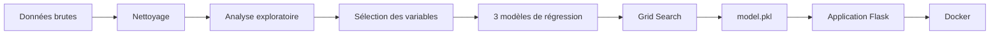
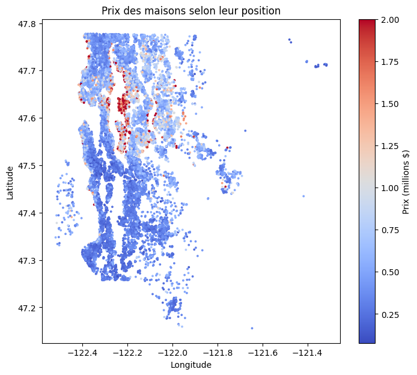
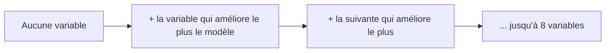
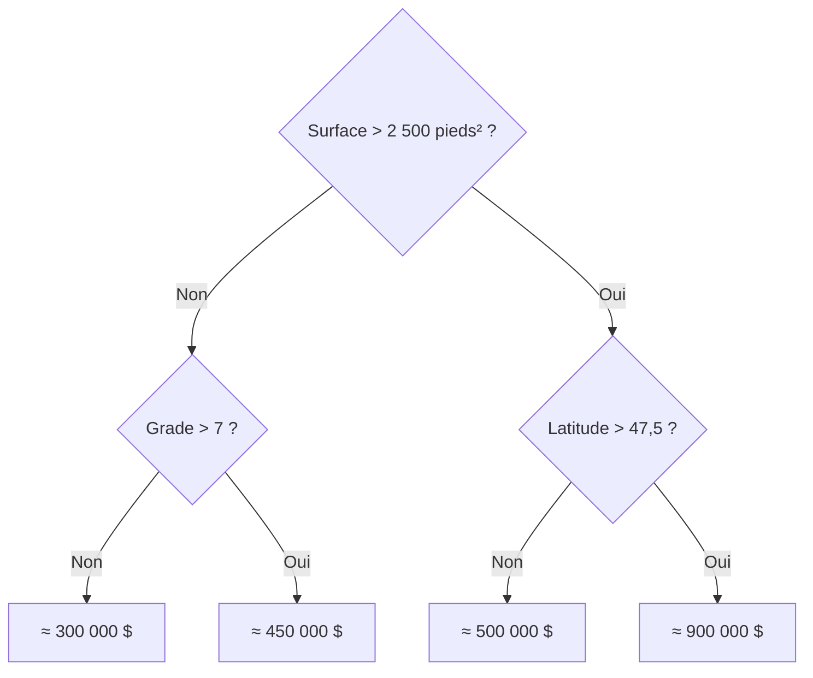
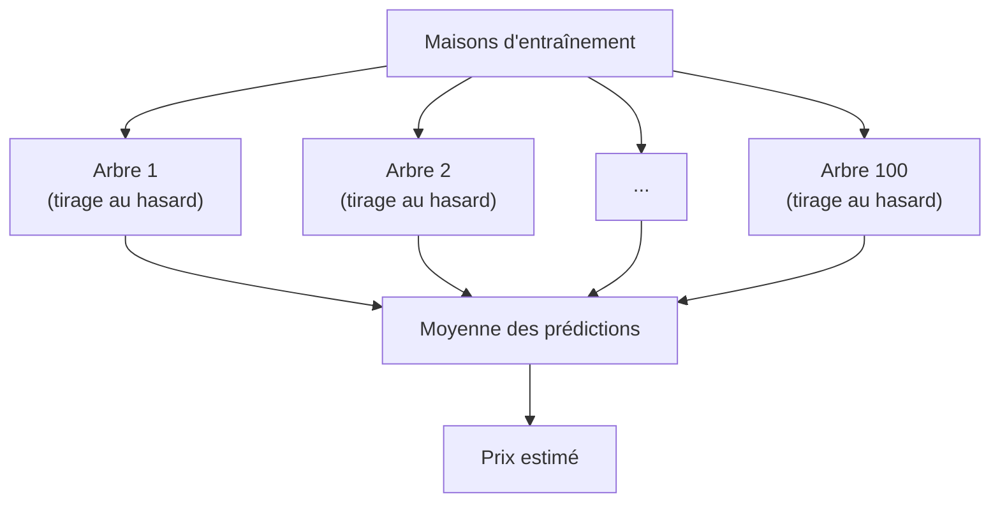
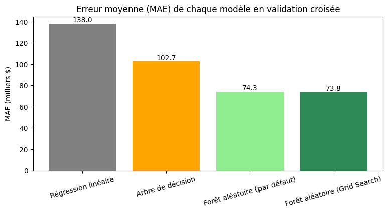
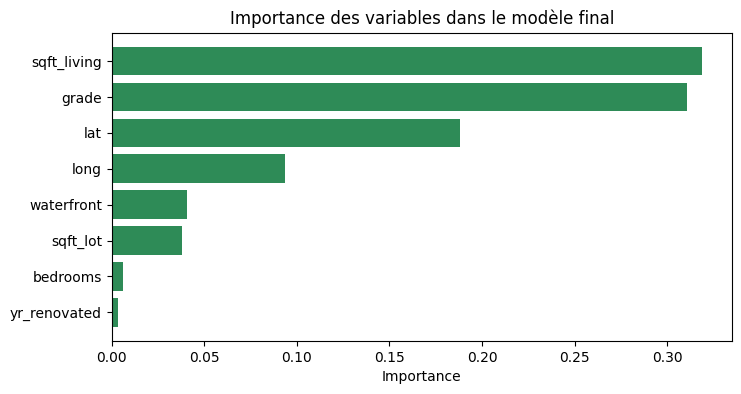

# Apartment Hunter

Outil d'estimation du prix d'une maison, réalisé dans le cadre du projet **« Chasseurs d'appart' »**.



## Contexte

Un agent immobilier passe beaucoup de temps à estimer le prix des biens qu'il doit vendre.
Dans le scénario du projet, un ancien data scientist se reconvertit en agent immobilier et décide d'utiliser ses compétences pour se créer un outil d'estimation de prix.

## Objectif

> **Peut-on estimer le prix d'une maison à partir de ses caractéristiques ?**

Le but est de construire un modèle de **régression** qui prédit le prix de vente d'une maison, puis de le rendre utilisable dans une petite application web Flask.

## Données

On avait le choix entre deux jeux de données (Madrid et King County). On a choisi **King County** parce qu'il a moins de colonnes, pas de texte libre et que chaque variable est bien documentée. Il est donc plus simple à nettoyer et à expliquer.

- **Source** : ventes de maisons du comté de King (région de Seattle, États-Unis) entre **mai 2014 et mai 2015**
- **Taille** : 21 613 ventes, 21 colonnes
- **Cible** : `price`, le prix de vente en dollars

| Variable | Signification |
|---|---|
| `price` | Prix de vente ($), **la cible** |
| `bedrooms` / `bathrooms` | Nombre de chambres / de salles de bain |
| `sqft_living` / `sqft_lot` | Surface habitable / surface du terrain (pieds², 1 m² ≈ 10,76 pieds²) |
| `floors` | Nombre d'étages |
| `waterfront` | Vue sur l'eau (0 ou 1) |
| `view` | Qualité de la vue (0 à 4) |
| `condition` | État de la maison (1 à 5) |
| `grade` | Qualité de construction (1 à 13, 7 = moyen) |
| `sqft_above` / `sqft_basement` | Surface hors sol / sous-sol |
| `yr_built` / `yr_renovated` | Année de construction / de rénovation (0 = jamais rénovée) |
| `zipcode`, `lat`, `long` | Code postal, latitude, longitude |
| `sqft_living15` / `sqft_lot15` | Surfaces moyennes des 15 maisons voisines |
| `id`, `date` | Identifiant et date de la vente |

## Organisation du projet

### Feuille de route

| # | Tâche | Durée estimée | Responsable |
|---|---|---|---|
| 1 | Lecture du sujet, choix du jeu de données, création du GitHub et du Trello | 0,5 jour | Équipe |
| 2 | Compréhension des données | 0,5 jour | Équipe |
| 3 | Nettoyage des données | 0,5 jour | Romain |
| 4 | Analyse exploratoire (graphiques + dashboard) | 0,5 jour | Romain |
| 5 | Sélection des variables | 0,5 jour | Yannis |
| 6 | Entraînement et comparaison des 3 modèles | 1 jour | Yannis |
| 7 | Grid Search et choix du modèle final | 0,5 jour | Lisa |
| 8 | Application Flask | 1 jour | Lisa |
| 9 | Docker | 0,5 jour | Lisa |
| 10 | README, documentation et veille | 0,5 jour | Équipe |
| 11 | Préparation de la présentation | 0,5 jour | Équipe |
| | **Total** | **6,5 jours** | |

### Ressources

- **Humaines** : 3 personnes.
  - **Romain** : données, nettoyage, analyse exploratoire et logique globale du projet
  - **Yannis** : sélection des variables, modèles et métriques
  - **Lisa** : Grid Search, modèle final, application Flask et Docker
  - En équipe : mise en place, compréhension des données, documentation et présentation
- **Matérielles** :
  - nos ordinateurs portables (pas besoin de GPU : les modèles s'entraînent en quelques minutes)
  - Google Colab (gratuit) pour le notebook
  - GitHub pour le code
  - Trello pour le suivi des tâches
  - un navigateur web
  - Docker Desktop (gratuit) pour tester le conteneur

### Trello

Le tableau Trello suit la méthode **Kanban**, avec 3 colonnes : **À faire**, **En cours** et **Terminé**. Une carte correspond à une tâche de la feuille de route.

Lien du tableau : *(à ajouter)*

### Structure du dépôt

```
apartment-hunter/
├── apartment_hunter.ipynb    # notebook : du nettoyage jusqu'au modèle final
├── data/
│   └── kc_house_data.csv     # données
├── images/                   # graphiques générés par le notebook
├── dashboard.html            # analyse exploratoire consultable (remplace Power BI)
├── app.py                    # application Flask
├── model.pkl                 # modèle final enregistré avec joblib
├── templates/
│   └── index.html            # page de l'application
├── static/
│   └── style.css             # mise en forme de la page
├── requirements.txt          # librairies nécessaires à l'application
├── Dockerfile                # script Docker
└── README.md
```

## Nettoyage des données

Les données étaient déjà propres : **aucune valeur manquante** et **aucune ligne en double**. Le nettoyage est donc volontairement léger.

| Étape | Ce qu'on a trouvé | Décision |
|---|---|---|
| Valeurs manquantes | 0 | Rien à faire |
| Lignes en double | 0 | Rien à faire |
| `id` en double | 177 maisons vendues 2 fois, à des dates différentes | Gardées : ce sont de vraies ventes |
| `id` | Simple identifiant | Supprimé |
| `date` | Les ventes couvrent seulement environ 13 mois (2 mai 2014 → 27 mai 2015). Pour garder le projet simple, on n'étudie pas l'effet du temps | Supprimé |
| `zipcode` | Un code, pas une quantité. La localisation est déjà donnée par `lat` et `long` | Supprimé |
| `sqft_above`, `sqft_basement` | Leur somme est exactement égale à `sqft_living` pour toutes les maisons | Supprimés (en double avec la surface) |
| Maison à 33 chambres | 1 620 pieds² et 1,75 salle de bain : faute de frappe | 1 ligne supprimée |
| 0 chambre ou 0 salle de bain | Par exemple une maison de 4 810 pieds² à 1,3 M$ sans chambre ni salle de bain | 16 lignes supprimées |
| Maisons très chères | 1 145 maisons (5,3 %) au-dessus de la limite IQR (≈ 1,13 M$) | **Gardées** : maisons de luxe réelles, pas des erreurs |
| Normalisation / standardisation | Inutile pour les arbres, et ne change pas les prédictions de la régression linéaire | Non appliquée |

**Résultat** : on passe de 21 613 lignes × 21 colonnes à **21 596 lignes × 16 colonnes**.

## Analyse exploratoire

> **Power BI n'était pas disponible.** L'analyse exploratoire a donc été refaite avec des outils gratuits : Python et matplotlib dans Google Colab.
> Les graphiques sont regroupés dans le fichier **[`dashboard.html`](dashboard.html)**, à ouvrir dans un navigateur (après avoir téléchargé le dépôt). Il remplace le dashboard Power BI demandé.

Les principaux constats :

| Graphique | Ce qu'on voit |
|---|---|
| Distribution des prix | 93,1 % des maisons coûtent moins de 1 M$, prix médian de 450 000 $ |
| Surface / prix | Le prix augmente avec la surface (corrélation de 0,70) |
| Grade / prix | Le prix augmente globalement avec le grade : 0,38 M$ au grade 7, 2,98 M$ au grade 13 (le grade 3 dépasse le grade 4, mais ces groupes ont 1 et 27 maisons) |
| Chambres / prix | La tendance monte globalement jusqu'à environ 7 chambres. Au-delà, très peu de maisons (13, 6, 3 et 1) : pas de tendance fiable |
| Vue / prix | 0,43 M$ sans vue contre 1,18 M$ avec une vue excellente. Avec vue sur l'eau : 1,4 M$ contre 450 000 $ |
| Carte | Des zones sont nettement plus chères, alors que la corrélation de la longitude avec le prix est presque nulle (0,02) |
| Corrélations | `sqft_living`, `grade`, `bathrooms` et `sqft_living15` sont très liées entre elles (≈ 0,7 à 0,76) |



## Sélection des variables

La sélection est faite **uniquement sur les données d'entraînement**, pour ne pas « tricher » avec le jeu de test.

**Méthode 1 : corrélation avec le prix.** Les variables les plus corrélées sont `sqft_living` (0,70), `grade` (0,67), `sqft_living15` (0,59), `bathrooms` (0,53) et `view` (0,40). Mais cette méthode ne voit que les liens « en ligne droite » (la longitude est à 0,017 alors que la carte montre que l'emplacement compte), et elle ne voit pas quand deux variables disent la même chose.

**Méthode 2 : sélection forward** (`SequentialFeatureSelector`). On part de zéro variable, et on ajoute à chaque étape celle qui améliore le plus le modèle (ici un arbre de décision limité à 10 niveaux), jusqu'à en avoir 8.



**Variables retenues (8)** : `sqft_living`, `grade`, `lat`, `long`, `waterfront`, `sqft_lot`, `bedrooms`, `yr_renovated`.

Une forêt aléatoire évaluée par validation croisée obtient un R² de **0,856 avec les 15 variables** et de **0,855 avec les 8**. On enlève donc 7 variables sans perdre en précision, et le formulaire de l'application reste court.

## Modèles testés

On fait de la **régression** : on prédit un nombre (le prix). Trois algorithmes ont été testés.

### Régression linéaire

Elle cherche la meilleure « formule » qui relie les variables au prix :

> prix ≈ a × surface + b × grade + c × chambres + … + constante

L'algorithme choisit les coefficients a, b, c… qui font les plus petites erreurs sur les maisons d'entraînement.

- **+** très simple, rapide, facile à interpréter
- **−** ne peut représenter que des relations « en ligne droite »

### Arbre de décision

Il pose une suite de questions oui/non sur les variables pour ranger les maisons dans des groupes de prix proches. Le prix estimé est la moyenne des prix des maisons du groupe final.

*Exemple simplifié (les seuils et les prix ont été choisis pour l'illustration) :*



- **+** facile à comprendre, peut représenter des relations qui ne sont pas en ligne droite
- **−** s'il n'est pas limité, il apprend les données par cœur (**surapprentissage**)

### Forêt aléatoire (Random Forest)

Elle construit **beaucoup d'arbres** (100 par défaut). Chaque arbre est entraîné sur un tirage au hasard des maisons d'entraînement (certaines maisons sont tirées plusieurs fois, d'autres pas du tout), donc les arbres sont tous un peu différents. La prédiction finale est la **moyenne** des prédictions de tous les arbres.



- **+** en général bien plus précise qu'un arbre seul : les erreurs des arbres se compensent
- **−** plus lente et plus difficile à expliquer en détail qu'un arbre seul, et le fichier du modèle est plus lourd

## Comparaison des modèles

Données découpées en **80 % entraînement / 20 % test** (`random_state=42`) : 17 276 maisons pour apprendre, 4 320 pour l'évaluation finale.

**Règle suivie** : tous les choix (variables, modèle, paramètres) sont faits **uniquement sur le train**, avec une **validation croisée** en 3 parts (on entraîne sur 2 parts, on mesure sur la 3ᵉ, trois fois, puis on fait la moyenne). Le jeu de test n'est utilisé **qu'une seule fois**, à la fin, pour évaluer le modèle final.

Les mesures utilisées :
- **MAE** : erreur moyenne, en dollars
- **RMSE** : erreur en dollars qui pénalise davantage les grosses erreurs
- **R²** : part des variations du prix expliquée par le modèle (1 = parfait)

Résultats en validation croisée sur le train :

| Modèle | MAE | RMSE | R² |
|---|---|---|---|
| Régression linéaire | 138 007 $ | 217 074 $ | 0,652 |
| Arbre de décision | 102 744 $ | 187 545 $ | 0,740 |
| Forêt aléatoire (par défaut) | 74 266 $ | 139 914 $ | 0,855 |
| **Forêt aléatoire (Grid Search)** | **73 764 $** | **139 413 $** | **0,856** |



- La **régression linéaire** est la moins bonne : le prix ne dépend pas en ligne droite de la position (latitude, longitude).
- L'**arbre de décision** fait du surapprentissage : R² de 0,999 sur les maisons qu'il a apprises, mais 0,740 en validation croisée.
- La **forêt aléatoire** est la meilleure sur les 3 mesures. Elle aussi a un écart (0,982 contre 0,855), mais elle reste bien meilleure que l'arbre seul.

## Optimisation avec Grid Search

Grid Search teste plusieurs combinaisons de paramètres et garde celle qui donne les meilleurs résultats, ici par validation croisée en 3 parts **sur le train**.

Grille testée sur la forêt aléatoire (12 combinaisons) :

| Paramètre | Valeurs testées | Meilleure valeur |
|---|---|---|
| `n_estimators` (nombre d'arbres) | 100, 200 | **200** |
| `max_depth` (profondeur max) | 10, 15, aucune limite | **15** |
| `min_samples_split` | 2, 10 | **2** |

| Forêt aléatoire (validation croisée) | MAE | RMSE | R² |
|---|---|---|---|
| Paramètres par défaut | 74 266 $ | 139 914 $ | 0,855 |
| Après Grid Search | **73 764 $** | **139 413 $** | **0,856** |

L'amélioration est **très petite** (environ 500 $ d'erreur moyenne en moins), ce qui montre que les paramètres par défaut étaient déjà bons. La grille est volontairement petite pour garder un temps de calcul raisonnable sur Colab.

## Modèle final

**Forêt aléatoire optimisée** (200 arbres, profondeur max 15), choisie car elle a le meilleur R² en validation croisée, puis entraînée sur tout le train avec 8 variables.

Évaluation finale, faite **une seule fois** sur les 4 320 maisons du test :

| | MAE | RMSE | R² |
|---|---|---|---|
| Modèle final sur le jeu de test | **71 718 $** | **126 924 $** | **0,877** |

- Le modèle explique 87,7 % des variations de prix sur des maisons jamais vues.
- Il se trompe en moyenne de 71 718 $, soit environ 16 % du prix médian.
- Le score sur le test est proche de la validation croisée (0,856), et même un peu meilleur : le modèle final apprend sur tout le train, alors qu'en validation croisée chaque modèle n'apprenait que sur 2/3 du train.

Les variables les plus utilisées par le modèle sont la surface (`sqft_living`, 0,319), la qualité (`grade`, 0,311) et l'emplacement (`lat` 0,188 + `long` 0,093).



Le modèle est enregistré avec `joblib` dans `model.pkl` (26,3 Mo grâce à `compress=3`, sous la limite de 100 Mo de GitHub).

> Le modèle a été entraîné avec **scikit-learn 1.8.0**. Si on relance le notebook sur Colab avec une autre version et qu'on remplace `model.pkl`, il faut mettre la version affichée en haut du notebook dans `requirements.txt`. Les résultats peuvent alors varier très légèrement.

## Application Flask

L'application affiche un formulaire avec les 8 caractéristiques de la maison. Quand on clique sur **Estimer**, elle donne les valeurs au modèle et affiche le prix estimé.

Fonctionnement de `app.py` :
1. au démarrage, le modèle est chargé une seule fois avec `joblib.load("model.pkl")`
2. la route `/` affiche la page `templates/index.html`
3. quand le formulaire est envoyé (méthode POST), on récupère les 8 valeurs, on les met dans un tableau pandas d'une ligne (dans le même ordre que pendant l'entraînement) et on appelle `model.predict()`
4. le prix est renvoyé à la page et affiché dans un encadré vert

Pas de transformation des données à refaire dans l'application, puisqu'on n'a fait ni normalisation ni encodage.

**Lancer l'application sans Docker** :

```bash
pip install -r requirements.txt
python app.py
```

Puis ouvrir http://localhost:5000

Exemple à tester (une maison du jeu de test, vendue 415 000 $) : 3 chambres, 1 510 pieds², terrain de 6 083 pieds², pas de vue sur l'eau, grade 6, jamais rénovée, latitude 47.6966, longitude -122.324. Le modèle estime **375 210 $**.

## Docker

Docker permet de mettre l'application et ses dépendances dans un même environnement (un **conteneur**), afin qu'elle fonctionne de la même manière sur n'importe quel ordinateur.

| Instruction | Rôle |
|---|---|
| `FROM python:3.12-slim` | Image de départ : un système léger avec Python 3.12 déjà installé |
| `WORKDIR /app` | Dossier de travail dans le conteneur |
| `COPY requirements.txt .` | Copie la liste des librairies dans le conteneur |
| `RUN pip install ...` | Installe les librairies |
| `COPY app.py model.pkl ./` (et `templates`, `static`) | Copie les fichiers de l'application |
| `EXPOSE 5000` | Indique que l'application utilise le port 5000 |
| `CMD ["python", "app.py"]` | Commande lancée au démarrage du conteneur |

**Construire et lancer le conteneur** (Docker Desktop doit être ouvert) :

```bash
docker build -t apartment-hunter .
```

```bash
docker run -p 5000:5000 apartment-hunter
```

Puis ouvrir http://localhost:5000

> Le sujet parle d'un fichier `.dockerfile`. On a gardé le nom standard **`Dockerfile`**, que `docker build` trouve automatiquement.

## Conclusion

**Oui, on peut estimer le prix d'une maison à partir de ses caractéristiques**, avec une précision correcte : le modèle final explique 87,7 % des variations de prix sur des maisons jamais vues et se trompe en moyenne d'environ 72 000 $.

Ce qu'on retient :
- le prix dépend surtout de la **surface**, de la **qualité de construction** et de l'**emplacement**
- 8 variables suffisent pour avoir la même précision qu'avec toutes les variables
- la forêt aléatoire est nettement meilleure que la régression linéaire et que l'arbre seul
- le Grid Search apporte un très petit gain
- tous les choix ont été faits par validation croisée sur le train, et le test n'a servi qu'une fois, à la fin

Limites :
- c'est une **estimation indicative** : certaines erreurs sont beaucoup plus grandes que la moyenne (le RMSE est bien plus élevé que le MAE)
- les données datent de **2014-2015** et ne concernent que le **comté de King** : le modèle ne peut pas servir tel quel ailleurs ou pour les prix actuels
- l'utilisateur doit connaître la latitude et la longitude du logement

Pistes d'amélioration : des données plus récentes, la date de vente sur plusieurs années, des modèles plus avancés (gradient boosting), la saisie d'une adresse plutôt que des coordonnées.

## Veille technologique / documentation

Ressources utilisées pendant le projet :

- **Gestion de projet** : [Feuille de route : définition, outils, exemples](https://www.officetimeline.com/fr/feuille-de-route), [Méthode Kanban](https://www.appvizer.fr/magazine/operations/gestion-de-projet/kanban)
- **scikit-learn** :
  - [Documentation générale](https://scikit-learn.org/stable/)
  - [Régression linéaire](https://scikit-learn.org/stable/modules/linear_model.html#ordinary-least-squares)
  - [Arbres de décision](https://scikit-learn.org/stable/modules/tree.html)
  - [Forêts aléatoires](https://scikit-learn.org/stable/modules/ensemble.html#random-forests-and-other-randomized-tree-ensembles)
  - [Sélection de variables (SequentialFeatureSelector)](https://scikit-learn.org/stable/modules/feature_selection.html#sequential-feature-selection)
  - [Grid Search](https://scikit-learn.org/stable/modules/grid_search.html)
  - [Mesures de régression (MAE, RMSE, R²)](https://scikit-learn.org/stable/modules/model_evaluation.html#regression-metrics)
- **Sélection de variables** : [Boruta](https://pypi.org/project/Boruta/), étudié mais pas utilisé. Deux méthodes plus simples (corrélation + sélection forward) suffisaient ici.
- **Visualisation** : [matplotlib](https://matplotlib.org/stable/), utilisé à la place de [Power BI](https://learn.microsoft.com/fr-fr/power-bi/), qui n'était pas disponible
- **Application** : [Flask - Quickstart](https://flask.palletsprojects.com/en/3.0.x/quickstart/)
- **Conteneur** : [Documentation Docker](https://docs.docker.com/)
- **Sauvegarde du modèle** : [joblib](https://joblib.readthedocs.io/)
